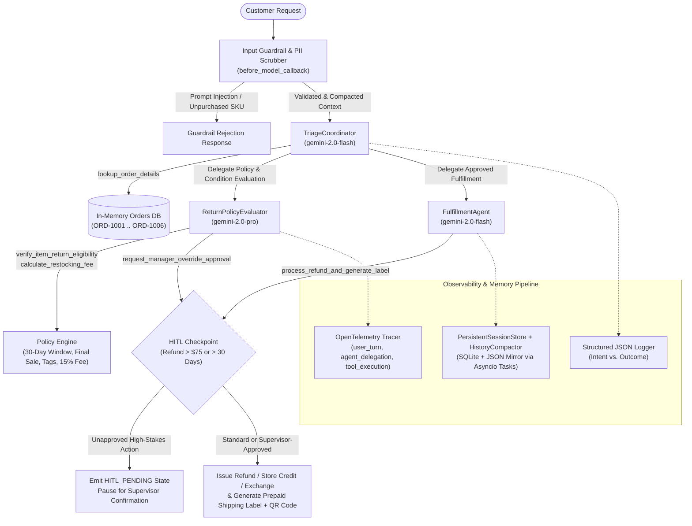

# Omnichannel Retail Return & Exchange Concierge

An enterprise-grade, multi-agent AI concierge built with the **Google Agent Development Kit (ADK)**, **Pydantic v2**, and **OpenTelemetry** on Google Cloud. The agent automates omnichannel retail returns, exchanges, store credit issuance, restocking fee calculations, and prepaid return label/QR generation while enforcing strict policy guardrails, **Human-in-the-Loop (HITL)** supervisor checkpoints, **PII redaction**, and **persistent session memory**.

---

## 1. Problem Statement & System Architecture

### Problem Statement
Retailers operating across online, mobile app, and physical brick-and-mortar store channels face high support volumes and margin leakage when handling customer returns and exchanges. Support agents must simultaneously:
1. Locate orders across disparate channels using order IDs or fallback customer identifiers (loyalty email or phone number).
2. Enforce nuanced return policies: **30-day return windows**, **original retail tags & condition checks**, **15% restocking fees** for opened non-defective items, **Final Sale exclusions**, and **receipt verification**.
3. Prevent abuse, prompt injection, and unpurchased-item refund fraud while escalating high-stakes actions (**refunds > $75.00** or **returns past 30 days**) to human supervisors.
4. Protect sensitive customer **Personally Identifiable Information (PII)** (credit cards, CVVs, phone numbers, and email addresses) across logs, distributed traces, and persistent session storage.

### Multi-Agent Architecture

The system implements a **Coordinator / Specialist** multi-agent architecture with **Strategic Model Routing**, **Human-in-the-Loop (HITL)** checkpoints, and an end-to-end **Observability & Memory Pipeline**:



### Key Architectural Components
- **`TriageCoordinator` (`gemini-2.0-flash`)**: Front-door concierge that greets the customer, extracts order/item intent, executes [`lookup_order_details`](file:///usr/local/google/home/aareanareza/fde-labs/l200/final-project/retail-returns-agent/app/tools/return_tools.py#L309-L493) (with guided fallback to email/phone), and delegates to specialist sub-agents.
- **`ReturnPolicyEvaluator` (`gemini-2.0-pro`)**: Deep-reasoning policy specialist that runs [`verify_item_return_eligibility`](file:///usr/local/google/home/aareanareza/fde-labs/l200/final-project/retail-returns-agent/app/tools/return_tools.py#L499-L975), [`calculate_restocking_fee`](file:///usr/local/google/home/aareanareza/fde-labs/l200/final-project/retail-returns-agent/app/agent.py#L752-L799), and [`request_manager_override_approval`](file:///usr/local/google/home/aareanareza/fde-labs/l200/final-project/retail-returns-agent/app/tools/return_tools.py#L981-L1277).
- **`FulfillmentAgent` (`gemini-2.0-flash`)**: Fulfillment specialist that executes [`process_refund_and_generate_label`](file:///usr/local/google/home/aareanareza/fde-labs/l200/final-project/retail-returns-agent/app/tools/return_tools.py#L1283-L1716) to issue RMA numbers, refunds/exchanges/store credits, and prepaid carrier labels or printerless QR codes.

---

## 2. Rubric Traceability Matrix (All 5 Categories & Criteria)

The table below maps every grading rubric category and criterion directly to the exact file paths, symbols, and line numbers in this repository:

| # | Rubric Category | Criterion | Implementation Evidence & Symbols | File Path & Line Numbers |
| :-: | :--- | :--- | :--- | :--- |
| **1** | **Category 1: Tool & Interface Design** | **1.1 Descriptive Naming** | Unambiguous, action-oriented tool names: `lookup_order_details`, `verify_item_return_eligibility`, `request_manager_override_approval`, `process_refund_and_generate_label`, and `calculate_restocking_fee`. | [`app/tools/return_tools.py#L309-L314`](file:///usr/local/google/home/aareanareza/fde-labs/l200/final-project/retail-returns-agent/app/tools/return_tools.py#L309-L314)<br/>[`app/tools/return_tools.py#L499-L507`](file:///usr/local/google/home/aareanareza/fde-labs/l200/final-project/retail-returns-agent/app/tools/return_tools.py#L499-L507)<br/>[`app/tools/return_tools.py#L981-L988`](file:///usr/local/google/home/aareanareza/fde-labs/l200/final-project/retail-returns-agent/app/tools/return_tools.py#L981-L988)<br/>[`app/tools/return_tools.py#L1283-L1293`](file:///usr/local/google/home/aareanareza/fde-labs/l200/final-project/retail-returns-agent/app/tools/return_tools.py#L1283-L1293)<br/>[`app/agent.py#L752-L757`](file:///usr/local/google/home/aareanareza/fde-labs/l200/final-project/retail-returns-agent/app/agent.py#L752-L757) |
| **2** | **Category 1: Tool & Interface Design** | **1.2 Explicit Schemas (Pydantic v2)** | Strict Pydantic v2 `StrictBaseModel` (`ConfigDict(strict=True, extra="forbid")`) for all tool inputs (`LookupOrderDetailsInput`, `VerifyItemReturnEligibilityInput`, `RequestManagerOverrideApprovalInput`, `ProcessRefundAndGenerateLabelInput`) and outputs (`LookupOrderDetailsOutput`, `VerifyItemReturnEligibilityOutput`, `RequestManagerOverrideApprovalOutput`, `ProcessRefundAndGenerateLabelOutput`, `OrderRecord`, `OrderItem`, `ReturnShippingLabel`, `ErrorDetail`). | [`app/models/schemas.py#L42-L604`](file:///usr/local/google/home/aareanareza/fde-labs/l200/final-project/retail-returns-agent/app/models/schemas.py#L42-L604) |
| **3** | **Category 1: Tool & Interface Design** | **1.3 Comprehensive Tool Docstrings** | Full Google-style docstrings (`Args:`, `Returns:`) on every tool detailing business rules, parameter constraints, and output schema fields. | [`app/tools/return_tools.py#L315-L347`](file:///usr/local/google/home/aareanareza/fde-labs/l200/final-project/retail-returns-agent/app/tools/return_tools.py#L315-L347)<br/>[`app/tools/return_tools.py#L508-L552`](file:///usr/local/google/home/aareanareza/fde-labs/l200/final-project/retail-returns-agent/app/tools/return_tools.py#L508-L552)<br/>[`app/tools/return_tools.py#L989-L1028`](file:///usr/local/google/home/aareanareza/fde-labs/l200/final-project/retail-returns-agent/app/tools/return_tools.py#L989-L1028)<br/>[`app/tools/return_tools.py#L1294-L1339`](file:///usr/local/google/home/aareanareza/fde-labs/l200/final-project/retail-returns-agent/app/tools/return_tools.py#L1294-L1339)<br/>[`app/agent.py#L758-L774`](file:///usr/local/google/home/aareanareza/fde-labs/l200/final-project/retail-returns-agent/app/agent.py#L758-L774) |
| **4** | **Category 1: Tool & Interface Design** | **1.4 Guided Error Handling & Mock DB** | Structured `ErrorDetail` and `Recovery:` instructions on validation/business logic errors (`ORDER_NOT_FOUND`, `OUTSIDE_RETURN_WINDOW`, `FINAL_SALE_ITEM_INELIGIBLE`, `MISSING_RECEIPT`, `HIGH_VALUE_OVERRIDE_REQUIRED`) + `MOCK_ORDERS_DB` (`ORD-1001` to `ORD-1006`). | [`app/tools/return_tools.py#L64-L269`](file:///usr/local/google/home/aareanareza/fde-labs/l200/final-project/retail-returns-agent/app/tools/return_tools.py#L64-L269)<br/>[`app/tools/return_tools.py#L361-L425`](file:///usr/local/google/home/aareanareza/fde-labs/l200/final-project/retail-returns-agent/app/tools/return_tools.py#L361-L425)<br/>[`app/tools/return_tools.py#L571-L950`](file:///usr/local/google/home/aareanareza/fde-labs/l200/final-project/retail-returns-agent/app/tools/return_tools.py#L571-L950)<br/>[`app/tools/return_tools.py#L1044-L1242`](file:///usr/local/google/home/aareanareza/fde-labs/l200/final-project/retail-returns-agent/app/tools/return_tools.py#L1044-L1242)<br/>[`app/tools/return_tools.py#L1358-L1590`](file:///usr/local/google/home/aareanareza/fde-labs/l200/final-project/retail-returns-agent/app/tools/return_tools.py#L1358-L1590) |
| **5** | **Category 2: Context & Memory** | **2.1 Robust System Constitution** | `SYSTEM_CONSTITUTION` & specialist prompts defining empathetic concierge persona, 30-day window, original tags requirement, final-sale exclusions, `$75.00` HITL gate, and non-disclosure of internal fraud thresholds. | [`app/prompts.py#L28-L99`](file:///usr/local/google/home/aareanareza/fde-labs/l200/final-project/retail-returns-agent/app/prompts.py#L28-L99) |
| **6** | **Category 2: Context & Memory** | **2.2 History Compaction** | `HistoryCompactor` (`should_compact`, `summarize_turns`, `compact`, `compact_adk_contents`) summarizing older turns when turn/token thresholds are exceeded while preserving Order IDs, SKUs, emails, RMAs, and override codes. | [`app/memory/compactor.py#L65-L315`](file:///usr/local/google/home/aareanareza/fde-labs/l200/final-project/retail-returns-agent/app/memory/compactor.py#L65-L315)<br/>[`app/agent.py#L352-L367`](file:///usr/local/google/home/aareanareza/fde-labs/l200/final-project/retail-returns-agent/app/agent.py#L352-L367)<br/>[`app/agent.py#L917-L920`](file:///usr/local/google/home/aareanareza/fde-labs/l200/final-project/retail-returns-agent/app/agent.py#L917-L920) |
| **7** | **Category 2: Context & Memory** | **2.3 Persistent Session State** | `PersistentSessionStore` persisting session state, turns, and compacted summaries to SQLite (`.session_store/retail_concierge_sessions.db`) and JSON mirror (`.session_store/retail_concierge_sessions.json`) with automatic reload hydration. | [`app/memory/session_store.py#L57-L341`](file:///usr/local/google/home/aareanareza/fde-labs/l200/final-project/retail-returns-agent/app/memory/session_store.py#L57-L341)<br/>[`app/agent.py#L290-L301`](file:///usr/local/google/home/aareanareza/fde-labs/l200/final-project/retail-returns-agent/app/agent.py#L290-L301) |
| **8** | **Category 2: Context & Memory** | **2.4 Async Memory Operations** | Non-blocking background persistence and compaction via `asyncio.create_task` and `asyncio.to_thread` (`schedule_background_save_and_compact`, `save_session_async`, `compact_async`). | [`app/memory/session_store.py#L405-L554`](file:///usr/local/google/home/aareanareza/fde-labs/l200/final-project/retail-returns-agent/app/memory/session_store.py#L405-L554)<br/>[`app/memory/compactor.py#L264-L270`](file:///usr/local/google/home/aareanareza/fde-labs/l200/final-project/retail-returns-agent/app/memory/compactor.py#L264-L270)<br/>[`app/memory/compactor.py#L317-L330`](file:///usr/local/google/home/aareanareza/fde-labs/l200/final-project/retail-returns-agent/app/memory/compactor.py#L317-L330)<br/>[`app/agent.py#L382-L435`](file:///usr/local/google/home/aareanareza/fde-labs/l200/final-project/retail-returns-agent/app/agent.py#L382-L435) |
| **9** | **Category 3: Orchestration & Logic** | **3.1 Multi-Agent Pattern** | Coordinator/Specialist hierarchy with `TriageCoordinator` (root agent) delegating to `ReturnPolicyEvaluator` and `FulfillmentAgent`. | [`app/agent.py#L847-L911`](file:///usr/local/google/home/aareanareza/fde-labs/l200/final-project/retail-returns-agent/app/agent.py#L847-L911) |
| **10** | **Category 3: Orchestration & Logic** | **3.2 Strategic Model Routing** | Fast triage and fulfillment routed to `gemini-2.0-flash` (`FAST_TRIAGE_MODEL`), and complex policy/restocking/exception evaluation routed to `gemini-2.0-pro` (`DEEP_POLICY_MODEL`). | [`app/agent.py#L86-L87`](file:///usr/local/google/home/aareanareza/fde-labs/l200/final-project/retail-returns-agent/app/agent.py#L86-L87)<br/>[`app/agent.py#L849`](file:///usr/local/google/home/aareanareza/fde-labs/l200/final-project/retail-returns-agent/app/agent.py#L849)<br/>[`app/agent.py#L870`](file:///usr/local/google/home/aareanareza/fde-labs/l200/final-project/retail-returns-agent/app/agent.py#L870)<br/>[`app/agent.py#L891`](file:///usr/local/google/home/aareanareza/fde-labs/l200/final-project/retail-returns-agent/app/agent.py#L891)<br/>[`app/config.py#L109-L116`](file:///usr/local/google/home/aareanareza/fde-labs/l200/final-project/retail-returns-agent/app/config.py#L109-L116) |
| **11** | **Category 3: Orchestration & Logic** | **3.3 Human-in-the-Loop (HITL) Hook** | `evaluate_hitl_requirement` and `hitl_and_guardrail_before_tool_callback` halting execution (`status="HITL_PENDING"`, `tool_context.request_confirmation`) on refunds `> $75.00` or returns `> 30` days until human supervisor approval is granted. | [`app/agent.py#L442-L533`](file:///usr/local/google/home/aareanareza/fde-labs/l200/final-project/retail-returns-agent/app/agent.py#L442-L533)<br/>[`app/agent.py#L658-L780`](file:///usr/local/google/home/aareanareza/fde-labs/l200/final-project/retail-returns-agent/app/agent.py#L658-L780)<br/>[`app/agent.py#L835-L840`](file:///usr/local/google/home/aareanareza/fde-labs/l200/final-project/retail-returns-agent/app/agent.py#L835-L840) |
| **12** | **Category 3: Orchestration & Logic** | **3.4 Input & Tool Guardrails** | `detect_adversarial_or_injection_input`, `input_validation_guardrail_callback`, and tool-level SKU verification blocking prompt injection attempts and refund demands for unpurchased items. | [`app/agent.py#L109-L149`](file:///usr/local/google/home/aareanareza/fde-labs/l200/final-project/retail-returns-agent/app/agent.py#L109-L149)<br/>[`app/agent.py#L220-L350`](file:///usr/local/google/home/aareanareza/fde-labs/l200/final-project/retail-returns-agent/app/agent.py#L220-L350)<br/>[`app/agent.py#L587-L657`](file:///usr/local/google/home/aareanareza/fde-labs/l200/final-project/retail-returns-agent/app/agent.py#L587-L657) |
| **13** | **Category 4: Observability & Tracing** | **4.1 Structured JSON Logging** | `StructuredJsonFormatter` & `StructuredObservabilityLogger` outputting single-line JSON logs with `timestamp`, `session_id`, `log_level`, `event_type`, `message`, and `context` metadata (no bare `print` statements). | [`app/observability/logger.py#L79-L205`](file:///usr/local/google/home/aareanareza/fde-labs/l200/final-project/retail-returns-agent/app/observability/logger.py#L79-L205) |
| **14** | **Category 4: Observability & Tracing** | **4.2 Intent vs. Outcome Logging** | `@log_tool_intent_and_outcome` decorator, `log_tool_intent`, and `log_tool_outcome` logging `TOOL_INTENT` (tool, parameters, predicted purpose) immediately before execution and `TOOL_OUTCOME` (return value, latency_ms, status) immediately after execution. | [`app/observability/logger.py#L220-L369`](file:///usr/local/google/home/aareanareza/fde-labs/l200/final-project/retail-returns-agent/app/observability/logger.py#L220-L369)<br/>[`app/tools/return_tools.py#L306-L308`](file:///usr/local/google/home/aareanareza/fde-labs/l200/final-project/retail-returns-agent/app/tools/return_tools.py#L306-L308)<br/>[`app/agent.py#L536-L571`](file:///usr/local/google/home/aareanareza/fde-labs/l200/final-project/retail-returns-agent/app/agent.py#L536-L571) |
| **15** | **Category 4: Observability & Tracing** | **4.3 Distributed Tracing (OpenTelemetry)** | OpenTelemetry SDK `TracerProvider` and context managers creating spans for `user_turn` (`trace_user_turn`), `agent_delegation` (`trace_agent_delegation`), and `tool_execution` (`trace_tool_execution`). | [`app/observability/tracer.py#L46-L189`](file:///usr/local/google/home/aareanareza/fde-labs/l200/final-project/retail-returns-agent/app/observability/tracer.py#L46-L189)<br/>[`app/agent.py#L190-L217`](file:///usr/local/google/home/aareanareza/fde-labs/l200/final-project/retail-returns-agent/app/agent.py#L190-L217)<br/>[`app/agent.py#L305-L309`](file:///usr/local/google/home/aareanareza/fde-labs/l200/final-project/retail-returns-agent/app/agent.py#L305-L309) |
| **16** | **Category 4: Observability & Tracing** | **4.4 Active PII Redaction** | Regex and key-aware scrubber (`scrub_pii`, `scrub_text`, `PIIScrubber`) redacting credit card numbers (`[REDACTED_CREDIT_CARD]`), CVVs (`[REDACTED_CVV]`), phone numbers (`[REDACTED_PHONE]`), and emails (`[REDACTED_EMAIL]`) prior to logging, tracing, or disk persistence. | [`app/observability/pii_scrubber.py#L28-L155`](file:///usr/local/google/home/aareanareza/fde-labs/l200/final-project/retail-returns-agent/app/observability/pii_scrubber.py#L28-L155)<br/>[`app/observability/logger.py#L90-L95`](file:///usr/local/google/home/aareanareza/fde-labs/l200/final-project/retail-returns-agent/app/observability/logger.py#L90-L95)<br/>[`app/memory/session_store.py#L200-L205`](file:///usr/local/google/home/aareanareza/fde-labs/l200/final-project/retail-returns-agent/app/memory/session_store.py#L200-L205) |
| **17** | **Category 5: Infrastructure & CI/CD** | **5.1 Automated Evaluation Suite** | 10-case golden evaluation dataset (`tests/golden_dataset.json`) and automated `pytest` runner (`tests/test_eval_suite.py`) asserting agent intent, specialist routing, tool selection, policy eligibility, HITL flags, guided recovery, and PII redaction. | [`tests/golden_dataset.json#L1-L290`](file:///usr/local/google/home/aareanareza/fde-labs/l200/final-project/retail-returns-agent/tests/golden_dataset.json#L1-L290)<br/>[`tests/test_eval_suite.py#L75-L391`](file:///usr/local/google/home/aareanareza/fde-labs/l200/final-project/retail-returns-agent/tests/test_eval_suite.py#L75-L391) |
| **18** | **Category 5: Infrastructure & CI/CD** | **5.2 Infrastructure as Code (Terraform)** | Declarative Google Cloud Terraform configuration provisioning Cloud Run v2, Artifact Registry, Secret Manager secrets, least-privilege IAM Service Account, and Cloud Logging audit bucket/sink/metrics. | [`terraform/main.tf#L15-L268`](file:///usr/local/google/home/aareanareza/fde-labs/l200/final-project/retail-returns-agent/terraform/main.tf#L15-L268) |
| **19** | **Category 5: Infrastructure & CI/CD** | **5.3 Secure Secret Management** | Environment variable and Google Cloud Secret Manager resolver (`get_secret`, `AgentSettings` with `safe_dump`) ensuring zero hardcoded credentials, paired with `.env.example`. | [`app/config.py#L35-L144`](file:///usr/local/google/home/aareanareza/fde-labs/l200/final-project/retail-returns-agent/app/config.py#L35-L144)<br/>[`.env.example#L1-L26`](file:///usr/local/google/home/aareanareza/fde-labs/l200/final-project/retail-returns-agent/.env.example#L1-L26) |
| **20** | **Category 5: Infrastructure & CI/CD** | **5.4 CI/CD Pipeline** | GitHub Actions workflow triggered on `push` and `pull_request` to `main`, executing `ruff check`, `ruff format --check`, `codespell`, `ty check`, and `uv run pytest tests/ -v`. | [`.github/workflows/ci.yml#L1-L52`](file:///usr/local/google/home/aareanareza/fde-labs/l200/final-project/retail-returns-agent/.github/workflows/ci.yml#L1-L52) |

---

## 3. Getting Started: Installation, Local Execution, Evaluation & Deployment

### Prerequisites
- **Python**: `>= 3.11, < 3.14`
- **uv**: Fast Python package and environment manager (`curl -LsSf https://astral.sh/uv/install.sh | sh`)
- **Google Agents CLI** (optional, for interactive ADK playground and cloud deployment):
  ```bash
  uv tool install google-agents-cli
  ```

### Step 1: Install Dependencies
Clone the repository and synchronize all runtime, development, evaluation, and linting dependencies with `uv`:
```bash
uv sync --dev --extra lint --extra eval
```

### Step 2: Configure Environment Variables
Copy the provided `.env.example` template to `.env` and set your Google Cloud project details:
```bash
cp .env.example .env
```
Edit `.env` as needed (no secrets are ever committed to source control):
```dotenv
GOOGLE_CLOUD_PROJECT=your-gcp-project-id
GOOGLE_CLOUD_LOCATION=global
GOOGLE_GENAI_USE_VERTEXAI=true
FAST_TRIAGE_MODEL=gemini-2.0-flash
DEEP_POLICY_MODEL=gemini-2.0-pro
HITL_REFUND_THRESHOLD_USD=75.0
HITL_RETURN_WINDOW_DAYS=30
LOG_LEVEL=INFO
```
Authenticate with Google Cloud Application Default Credentials when invoking live Vertex AI models:
```bash
gcloud auth application-default login
```

### Step 3: Run the Agent Locally

#### Option A: Interactive ADK Web Playground
Launch the local interactive UI to test multi-turn conversations, inspect tool calls, and approve HITL checkpoints:
```bash
agents-cli playground
```

#### Option B: FastAPI + A2A Server
Run the FastAPI & Agent-to-Agent (A2A) server directly on `http://127.0.0.1:8000`:
```bash
uv run uvicorn app.fast_api_app:app --host 0.0.0.0 --port 8000 --reload
```

### Step 4: Run the Automated Evaluation Suite, Unit Tests & Linters

Run the complete test suite (including the 10-case golden evaluation suite in `tests/test_eval_suite.py`, all category unit tests in `tests/unit/`, and the integration tests in `tests/integration/`):
```bash
uv run pytest -v
```

Run only the golden dataset evaluation suite:
```bash
uv run pytest tests/test_eval_suite.py -v
```

Run the code quality and static analysis checks (matching the GitHub Actions CI workflow):
```bash
uv run ruff check .
uv run ruff format . --check
uv run codespell
uv run ty check
```

### Step 5: Deploy to Google Cloud

#### Option A: Provision Infrastructure with Terraform
```bash
cd terraform
terraform init
terraform plan -var="project_id=YOUR_GCP_PROJECT_ID" -var="region=us-central1"
terraform apply -var="project_id=YOUR_GCP_PROJECT_ID" -var="region=us-central1"
```

#### Option B: Deploy via `agents-cli`
```bash
agents-cli deploy
```
